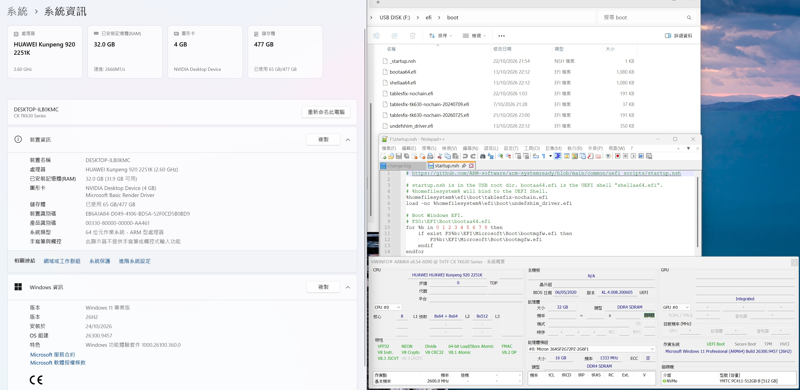

# Guide / builds to let TK630 or D920L11 run in Win11 ARM 26H2 #

- This repo is continued from [6DammK9/tk630-win11-23h2](https://github.com/6DammK9/tk630-win11-23h2#build-guide).



## Build guide (PC build) ##

### File contents ###

- Due to the scattered resources to be integrated, I have put the prebuilt files in the `Releases` section.
  - `tk630.zip`: Original BIOS extracted with [readnor.efi](https://github.com/6DammK9/d920s10/releases/tag/20261025). CH341A should have same reuslt. *Extract and patch your own BIOS is recommended.*
  - `tk630-mpam.zip`: Patched BIOS. Flash BIOS via "update firmware" (content will change, still works), or use CH341A again.
  - `usb-bootloader.zip`: Contains all the folder structures, EFI files, and startup script for an USB bootloader. Recommended to be a dedicated USB DOM.

```sh
dir -s
# startup.nsh
# efi\boot\bootaa64.efi
# efi\boot\tablesfix-nochain.efi
# efi\boot\undefshim_driver.efi
```

- For the `usb-bootloader.zip`:
  - `startup.nsh`: Included in this repo.
  - `bootaa64.efi`: Is the `shellaa64.efi` in [pbatard/UEFI-Shell](https://github.com/pbatard/UEFI-Shell/releases).
  - `tablesfix-nochain.efi`: As in my d920s10 fork, version `20261025`. [6DammK9/d920s10](https://github.com/6DammK9/d920s10/releases/tag/20261025)
  - `undefshim_driver.efi`: Included in this repo. Built from [dixyes-digital-wastes/undefshim](https://github.com/dixyes-digital-wastes/undefshim)

### Using the USB bootloader ###

- For OS install:
  - Prepare **2 USBs**: Bootloader USB (this repo), and the Win11 installation USB. The installation USB can be in original content
  - Always boot with the Bootloader USB. If the current disk is clean, let the script throws error and exit. If it is dirth (see limitation), or press `Esc` to exit early and load the EFI modules manually.
  - When the EFI modules are loaded, execute the `bootaa64.efi` in the Win11 installation USB (`efi\boot\bootaa64.efi` but in other FS number).
  - Use `map` to view the `FS:`, then `FS:` to navigate, and `ls` / `cat` to view the directory / file contents. *Basic UEFI shell commands.*
  - There may be BSOD while installation. *It is fine. Reboot the PC.*
  - As same as most bootloaders (23H2 build also), it may not able to shutdown by itself. *Shut it down manually like Win98.*

- After OS install:
  - Boot with the Bootloader USB, and everything should be in auto.

### Gathering Drivers ###

- Same as [6DammK9/tk630-win11-23h2](https://github.com/6DammK9/tk630-win11-23h2/tree/main#driver-support-in-win11-arm-23h2). However the MS Store is enabled by default.

## Limitation ##

- **DO NOT INSTALL WSL2! undefshim may break and you need to start all over again!**

## Build guide (Source build / patch BIOS) ##

- Compare with previous 23H2, this may be less complicated.

```sh
# For undefshim
# Ref: https://www.biosconfessions.com/posts/from-silicon-to-shell/2-toolchain-setup/
# Ref: https://www.reddit.com/r/rust/comments/s45mn7/how_to_crosscompile_from_linux_to_windows/?show=original
# LLVM-MinGW Clang Toolchains. Warning: 2-3GB of space (SDK matters)
sudo apt install gcc-aarch64-linux-gnu binutils-aarch64-linux-gnu clang llvm mingw-w64

# https://voxelmanip.se/2024/12/10/cross-compiling-for-windows-using-llvm-mingw/
wget https://github.com/mstorsjo/llvm-mingw/releases/download/20260922/llvm-mingw-20260922-ucrt-ubuntu-22.04-aarch64.tar.xz
tar -xf llvm-mingw-20260922-ucrt-ubuntu-22.04-aarch64.tar.xz
# 23.1.2
./llvm-mingw-20260922-ucrt-ubuntu-22.04-x86_64/bin/clang -v

git clone --recursive https://github.com/6DammK9/d920s10.git d920l11-261025
cd d920l11-261025
```

- Patch `Makefile`:

```makefile
# For ARM UEFI
CC = /opt/d920l11/llvm-mingw-20260922-ucrt-ubuntu-22.04-x86_64/bin/clang
# patch_bl only, any machine
HOST_CC = clang

# Remove licenses.o
tablesfix.efi: tablesfix.o dsdt_fix.o hob.o aml.o uacpi_kernel.o tlsf.o $(POSIX_UEFI_OBJS) $(UACPI_OBJS) $(CC) $(LDFLAGS) $^ -o $@
```

- Build files.

```sh
# Generate tablesfix.efi and readnor.efi
make
# Generate patch_bl
make patch_bl
```

- Use `readnor.efi` to extract `bios.bin`. Run it in UEFI shell.
  - Notice that the prebuilt in `20240709` doesn't work.
  - Same CRC32 / SHA256 for CH341A. Also 1.8V adapter should be used. ~~Sometimes it just survives 3.3V.~~

```sh
# UEFI shell. Esc to prevent startup.nsh
readnor.efi
# Takes some time. bios.bin is in root directory.
```

- Then patch the BIOS.

```log
$ ./patch_bl ./play/pt620k.bin ./play/pt620k-mpam.bin
This patch was developed for D920S10 / BC32MBSA BIOS, to patch EL3 in FIP image to enable MPAM
However it also applies with D920L11 / BC32MBHB a.k.a TK630, PT620K with similar UEFI BIOS.
This patch is ABSOLUTELY NO WARRANTY
USE AT YOUR OWN RISK

Hint: Search for 0x010064AA78563412 in HxD or UEFITool
Otherwise brute search for BL31 pattern, and scroll backward until 0xFF wall is found.
D920S10 use 0xba0000, but D920L11 is 0xbb0000
BL31 pattern: 47D4086D4CFE98469B952950CBBD5A00
Assembly to hack: FF4403D5000080D240111ED5

FIP_BL31: 0xbb0000, FIP_BINSIZE: 0x100000
UUID 1 in str: 47 D4 08 6D 4C FE 98 46 9B 95 29 50 CB BD 5A 
BL31 entry found at offset 0x00003235, size 0x0000a0f1
Found pattern 'Unhandled Interrupt Exception in EL3.
' at offset 0x0000b08b
Aligned stub start to offset 0x0000b08d
Found init pattern at offset 0x00003289
Found init pattern at offset 0x000033a1
Patch successful, output file ./play/pt620k-mpam.bin created
```

```log
$ ./patch_bl ./play/tk630.bin ./play/tk630-mpam.bin
This patch was developed for D920S10 / BC32MBSA BIOS, to patch EL3 in FIP image to enable MPAM
However it also applies with D920L11 / BC32MBHB a.k.a TK630, PT620K with similar UEFI BIOS.
This patch is ABSOLUTELY NO WARRANTY
USE AT YOUR OWN RISK

Hint: Search for 0x010064AA78563412 in HxD or UEFITool
Otherwise brute search for BL31 pattern, and scroll backward until 0xFF wall is found.
D920S10 use 0xba0000, but D920L11 is 0xbb0000
BL31 pattern: 47D4086D4CFE98469B952950CBBD5A00
Assembly to hack: FF4403D5000080D240111ED5

FIP_BL31: 0xbb0000, FIP_BINSIZE: 0x100000
UUID 1 in str: 47 D4 08 6D 4C FE 98 46 9B 95 29 50 CB BD 5A 
BL31 entry found at offset 0x000030c0, size 0x0000e228
Found pattern 'Unhandled Interrupt Exception in EL3.
' at offset 0x0000f36a
Aligned stub start to offset 0x0000f36c
Found init pattern at offset 0x00003148
Found init pattern at offset 0x000032e0
Patch successful, output file ./play/tk630-mpam.bin created
```

- Flash BIOS as BIOS update (see session above).

- Finally, the undefshim:

```sh
# cd ..
git clone --recursive https://github.com/dixyes-digital-wastes/undefshim.git undefshim
cd undefshim
```

- Patch `config.mk`:

```makefile
# Toolchain
# CC and LD are predefined by make, so a plain ?= would never take effect.
ifeq ($(origin CC),default)
CC := /opt/d920l11/llvm-mingw-20260922-ucrt-ubuntu-22.04-x86_64/bin/clang
endif
ifeq ($(origin LD),default)
LD := /opt/d920l11/llvm-mingw-20260922-ucrt-ubuntu-22.04-x86_64/bin/lld-link
endif
```

- And build the `undefshim_driver.efi`:

```sh
make
# Takes some time, create build/undefshim_driver.efi
```

### The undefshim outputs ###

- Expected result:
  - It will hang afterward without BIOS patch `patch_bl`.

```log
gmm: winload leaf found
gmm: done
work: collecting
plan: images 2 ntoskrnl=0x124a000 winload=0x34d000
plan: 1dapr W=1227 x=1766 b=538 h=97 total=3628
plan: sites 10 of 10
plan: site vbar-write ntoskrnl +0x505538 x8
plan: site vbar-write ntoskrnl +0x5057f8 x8
plan: site vbar-write ntoskrnl +0x637bec x3
plan: site transfer-leaf winload +0x109c
plan: site vbar-write winload +0x47a54 x8
plan: site vbar-write winload +0x47b70 x8
plan: site vbar-write winload +0x47cc8 x8
plan: site vbar-write winload +0x220550 x8
plan: site vbar-write winload +0x228314 x8
plan: site ttbr-handoff winload +0x2a7014
plan: pool bytes=159744 pages=39
plan: thunk ntoskrnl +0x63505c room=4004 of 7 in .text
plan: vbar sites=5 unresolved=2 tables=2
plan: vbar winload +0x1800 sync-inline=0x4e10084
plan: vbar winload +0x3800 sync-inline=0x41de95c
plan: complete=1
milestone: M5 planned
milestone: M6.5 transfer done
milestone: M6.5 armed
arm: driver load +0x9e40c8 -> thunk +0x6352b4 -> payload +0x1f88, call's target +0x30c4c0
milestone: M6.5 driver hook done
rewrite: ntoskrnl holds 3628
rewrite: 3628 in ntoskrnl
rewrite: winload holds 0
milestone: M7 rewritten
arm: stubs 16, rewritten 0
```

- After installing WSL2:
  - "arm driver" is missing, patch failed and hangs.

```log
gmm: winload leaf found
gmm: done
work: collecting
plan: images 2 ntoskrnl=0x13b000 winload=0x34d000
plan: 1dapr W=129 x=293 b=7 h=15 total=444
plan: sites 12 of 12
plan: site vbar-write ntoskrnl +0x608bc x8
plan: site vbar-write ntoskrnl +0x608e8 x9
plan: site vbar-write ntoskrnl +0x60904 x9
plan: site vbar-write ntoskrnl +0x64008 x0
plan: site vbar-write ntoskrnl +0x120aa4 x3
plan: site transfer-leaf winload +0x109c
plan: site vbar-write winload +0x47a54 x8
plan: site vbar-write winload +0x47b70 x8
plan: site vbar-write winload +0x47cc8 x8
plan: site vbar-write winload +0x220550 x8
plan: site vbar-write winload +0x228314 x8
plan: site ttbr-handoff winload +0x2a7014
plan: pool bytes=159744 pages=39
plan: thunk ntoskrnl +0x12b060 room=4000 of 11 in fothk
plan: vbar sites=5 unresolved=2 tables=2
plan: vbar winload +0x1800 sync-inline=0x4e10084
plan: vbar winload +0x3800 sync-inline=0x41de95c
plan: complete=1
milestone: M5 planned
milestone: M6.5 transfer done
arm: descriptor base not located (0 body(s), 0 load(s)) and none is configured; no site can be rewritten in place
milestone: M6.5 armed
arm: no driver load call to take over
milestone: M6.5 driver hook failed
rewrite: ntoskrnl holds 444
rewrite: 444 in ntoskrnl
rewrite: winload holds 0
milestone: M7 rewritten
arm: stubs 22, rewritten 0
```
